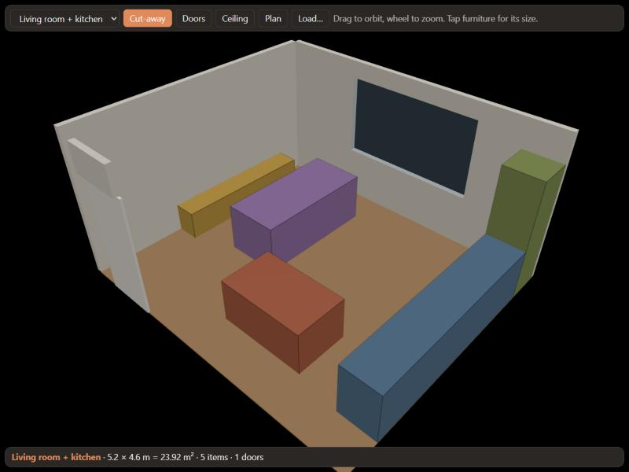

# Home Design Toolkit

**Plan your flat or house renovation with an AI assistant, and stop finding the mistakes after the carpenter leaves.**

11 skills, 4 agents, a `/home-design:start` command and four tested tools for Claude Code (or any agent that reads
Markdown instructions). Everything here comes from a real project: a complete 69 m² flat, from bare shell to bought
finishes, planned room by room with 3D models, layout audits and a lot of corrected assumptions.

Free and open source (MIT). No account, no API key, no installs beyond Node 18+.

*Georgian version: [README.ka.md](README.ka.md)*

[](https://github.com/gitkvash/home-design-toolkit/actions/workflows/test.yml)


## What it catches

```
$ node tools/clash-audit/audit.mjs examples/example-flat/plan.json
# living  clear floor 16.67 m2
out   ok []
ovl   ok []
swing ok []
route NARROW window: 68 cm (min 75)
route NARROW kitchen end: 60 cm (min 75)
```

The example flat looks fine on a picture. The audit says you cannot comfortably walk to the window or to the end of
the kitchen.



A door that hits the sofa, a dishwasher you cannot open with the oven door down, wallpaper ordered without the
pattern repeat, a pendant that does not fit the ceiling gap. These are the mistakes that cost money. The toolkit turns
them into checks.

## Install in Claude Code

```
/plugin marketplace add gitkvash/home-design-toolkit
/plugin install home-design@home-design-toolkit
```

Then run `/home-design:start` in an empty folder. It interviews you, creates a master plan, a brief, a decision log
and a `plan.json`, and tells you the five measurements that would improve accuracy most.

Other assistants (Cursor, Codex, Gemini CLI, ChatGPT projects): the skills are plain Markdown with a short
front-matter. Paste any `SKILL.md` into the agent's instruction files.

## What is inside

| | |
|---|---|
| **Skills** | `home-design-guide` (where to start, the order of work) · `home-survey` (plan screenshot + photos + tape → a plan you can trust) · `layout-clearances` (door swings, routes, clearances) · `interior-schemes` (comparable variants with a plain baseline) · `kitchen-planning` (appliances, sockets, circuits, gas, tile cuts, carpenter list) · `bathroom-planning` · `lighting-planning` (lux, zones, ceiling-gap fit) · `finishes-and-quantities` (floor, tile, wallpaper repeat and reserve, paint, radiators) · `product-research` (compare shops by price per m²) · `renovation-decisions` (append-only decision log, budget, order of works) · `build-3d-room-model` |
| **Agents** | `interior-designer` · `layout-auditor` (runs the audit, explains each fault, proposes the smallest fix) · `product-scout` · `renovation-planner` |
| **Command** | `/home-design:start`: interview and project setup |
| **Tools** | `clash-audit` (furniture through walls, overlaps, blocked door swings, narrow routes) · `quantities` (area, tiles, wallpaper rolls, paint, radiator watts, circuit load, lux) · `room-viewer` (one-file three.js 3D viewer with opening doors) · `product-research` (price normalisation, dedupe, polite scraper starter) |
| **Examples** | `examples/example-flat/`: an invented 2-room flat (`plan.json`) and a sample decision log |
| **Docs** | `docs/lessons-learned.md`: what went wrong and what we would do differently |

## Try the tools without an AI

```
node tools/clash-audit/audit.mjs examples/example-flat/plan.json
node tools/quantities/calc.mjs help
python -m http.server     # then open http://localhost:8000/tools/room-viewer/index.html
npm test
```

Plans are checked against [`tools/clash-audit/plan.schema.json`](tools/clash-audit/plan.schema.json) before the audit
runs. A malformed plan, or one written in centimetres instead of metres, exits with code 3 and a list of what is wrong.
Add `"$schema": "<path to plan.schema.json>"` to a plan to get the same checks in your editor.

## The method in eight lines

1. Measure before designing; every number gets a source and a tolerance.
2. Write the brief as rules the layout can be checked against.
3. Make several comparable schemes per room, always one plain baseline.
4. Audit geometry (doors, routes, walls), not impressions.
5. Plan kitchen, bath and lighting from services and rules, not pictures.
6. Choose finishes once for the whole home; compare products by price per m² with a reserve.
7. Keep an append-only decision log; after a purchase, freeze that category.
8. Hand each trade a drawing, not a render.

## Honest limits

These are planning aids, not structural, electrical, gas or waterproofing engineering. Confirm with licensed
professionals and local code. Photo-derived dimensions are ±5-10 cm; a tape measure beats everything here.

## Contributing

Issues and pull requests are welcome: local building rules from your country, new checks for the audit, better
defaults for the calculators, translations. See [CONTRIBUTING.md](CONTRIBUTING.md). If the toolkit saved you a
mistake, a ⭐ helps other people find it.

## License

MIT, see [LICENSE](LICENSE).
